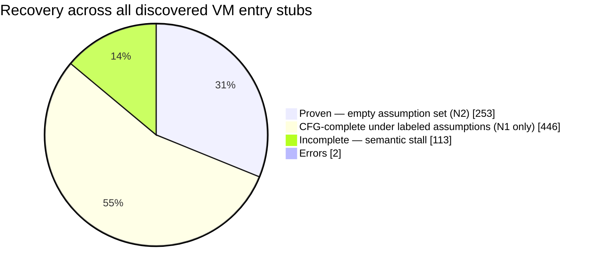
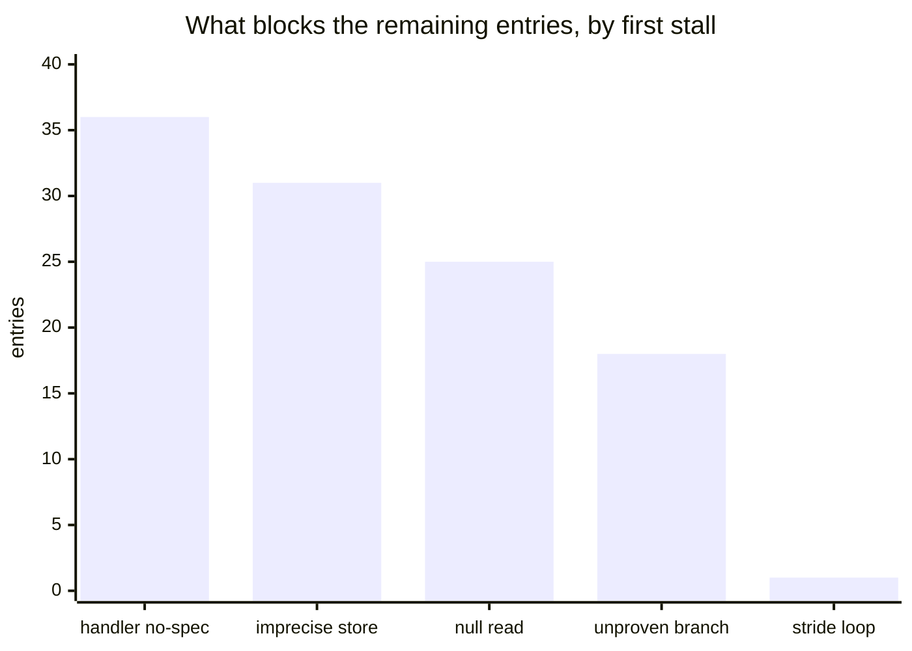

<h1 align="center">vmpx-expanded</h1>

<p align="center">
  <b>Static devirtualization and unpacking for VMProtect-protected x64 Windows binaries.</b><br>
  Strip the protector, recover the entry point and imports, devirtualize the
  guards — in one command.
</p>

<p align="center">
  <code>Rust</code> · <code>static-first</code> · the sample is never executed natively
</p>

---

A fork of [vmpx](https://github.com/skyboundfs/vmpx) that takes the pipeline all
the way to a behaviour-preserving, devirtualized PE. The original recovers a
great deal but deliberately stops short of emitting a clean binary; this fork
implements the remaining stages — entry-point recovery, import reconstruction,
native relocation, guard devirtualization — and wires them into a single command.

## Quick start

```sh
vmpx auto protected.dll clean.exe --dir out --log
```

One command runs the whole pipeline and reports each stage:

```
[vmpx] » ▶ start   Devirtualizing protected.dll
[vmpx] » i info    27 sections, image base 0x36b9a0000, 1259 import symbol(s)
[vmpx] » i info    protection: VmprotectLikely
[vmpx] » ▶ start   Analysing the application's protector references
[vmpx] » i info    reached 21 protector target(s): 14 guard(s), 7 mutated native(s)
[vmpx] » ▶ start   Rebuilding directories and stripping the protector   prev 69 ms
[vmpx] » ▶ start   Relocating mutated native functions                  prev 424 ms
[vmpx] » ▶ start   Devirtualizing guard functions                       prev 1.4 s
[vmpx] » ▶ start   Rebuilding the application import table              prev 69.1 s
[vmpx] » ▶ start   Verifying and writing                                prev 168 ms
[vmpx] » · file    out/clean.exe                                        204376064 bytes
[vmpx] » ✓ success clean PE written, 2 residual reference(s)            in 72.4 s
```

It analyses the binary and **chooses its own settings and targets** — the guard
and mutated-native addresses are discovered, not supplied. `--log` prints the
full per-step trace; a complete transcript is always written to `out/clean.log`.
With a packed input it unpacks first; `--snapshot <VMPXSNP1>` recovers the
application's imports (otherwise it asks before writing an image that will not
run). It never executes the protected sample — a contained software emulator
supplies the separate Observed tier, and that is the only thing that runs code.

### What each stage does

| stage | does |
|---|---|
| **unpack** | decompress a packed `.dll`/`.exe` to a mapped analysis image |
| **analyse** | find every protector reference the application's own code makes |
| **directories + strip** | rebuild the data directories out of `.vmp*`, remove the protector sections |
| **entry point** | recover the original `DllEntryPoint` by its CRT obligation, not a signature |
| **relocate** | move mutated-native functions out of the protector, verbatim, and repoint |
| **devirtualize** | lift the integrity guards to native, folding the checksum to a constant |
| **imports** | name the encrypted `.idata` slots from a snapshot and bind them in place |
| **verify** | prove no reference into removed space remains, then write |

## What it does

A single command takes a fully protected binary to a clean one and narrates every
step:

```
vmpx auto protected.exe -o clean.exe
```

It analyses the target and chooses its own instruction limit, step budget, and
assumption set — no flags required — then runs the whole chain:

- **Unpacks** the protected image and rebuilds a conventional section layout and
  data directories from it.
- **Recovers the original entry point** from the loader-obligation rule, with no
  reliance on symbols, a PDB, or DWARF.
- **Strips every `.vmp*` section** — the virtual machine, the mutated stubs, and
  the packed copy of the original — and proves nothing references the removed
  space before it writes.
- **Relocates mutated native functions** out of the protector verbatim and
  repoints their call sites.
- **Devirtualizes the integrity and timing guards**, folding each checksum to a
  constant against the intact image.
- **Rebinds the encrypted `.idata` imports** from a post-init snapshot, so the
  loader fills the slots the recovered code reads.
- **Reports recovery in three labeled tiers**, never one headline number, so a
  result is never silently conditional.

## Where it stands

Across the VM entry stubs discovered in a fully protected x64 target, recovery
falls into the three tiers below. The headline is not one number: an entry is
*proven* only when it closes with an empty assumption set.



| tier | share | meaning |
|---|---|---|
| **N1** — CFG-complete under any labeled assumption | **~86%** | control-flow graph closed, every assumption named in the output |
| **N2** — complete with an *empty* assumption set | **~31%** | nothing taken on trust; the number that carries weight |
| incomplete | ~14% | a semantic stall, not a budget one |

Every incomplete entry is a *semantic* stall — none is bounded by time or
instruction budget, so no increase in any budget converts them. What remains is a
modelling problem, and three of its four classes are the same problem: memory
precision.



| blocker | class | what it needs |
|---|---|---|
| handler has no recovered specification | control flow | prove a conditional predicate opaque before crossing it |
| imprecise external-memory store | memory | semantics for the address-computation intrinsics |
| proven-null read | memory | a post-init snapshot that reaches the slot |
| branch target depends on unproven input | memory | memory precision (almost all are reads of havoc'd memory) |
| VM-stack-stride loop | loop | — |

**The cheap fixes are wrong, not weak.** Each class has had several plausible
fixes tried and reverted, and in every case the result was an *incorrect* CFG
rather than a conservatively labeled one — walking a handler trace past a
conditional recovers postludes no execution performs; widening the store
disjointness gates buys nothing when the store address is `f(frame_pointer)` for
an opaque `f`. Each attempt and its measurement is recorded in the code at the
place it was made, so the next reader meets it rather than repeating it.

## The three tiers

The report is deliberately three numbers rather than one, because "recovered" is
not a single property:

- **N1 — CFG-complete.** The VM control-flow graph closed with no stalls, under
  an explicitly *labeled* set of assumptions. Every assumption is named in the
  output (`AssumesImageProtectionStable`,
  `AssumesExternalStoresDisjointFromVmStack`, `AssumesCrossVmSectionContinuation`,
  and so on), so a result is never silently conditional.
- **N2 — PROVEN.** The same, with an **empty** assumption set. Nothing was taken
  on trust. N2 is a subset of N1 and is the number that actually carries weight.
- **N3 — proven-equivalent.** Recovered semantics checked against the recompiled
  replacement. Not currently wired at the PE level.

Assumptions are *conceded*, never assumed away. Closing a loop by shifting the
VM stack base, for example, concedes frame privacy, so such an entry can reach N1
and is barred from N2 by construction.

## Soundness discipline

The parts worth knowing before trusting any output:

- **Fail closed.** Every recovery step refuses rather than guessing. A stall is
  recorded with its cause and the entry stays incomplete.
- **Labeled, not silent.** Anything unproven becomes a named assumption attached
  to that entry's result.
- **Three self-checks** per emitted function: an IR round-trip (the structured
  program against its own IR on random vectors), a C-text re-evaluation under real
  C typing and UB rules, and a linkage check against the independently unrolled
  recovered paths.
- **Honest widening.** Where abstract interpretation must generalize, it widens to
  an explicit unknown rather than narrowing to a convenient value, and the
  resulting imprecision shows up as a refusal downstream instead of as output.

## Build

```bash
cargo build --release
cargo run -p vmpx-cli -- --help
```

Useful entry points:

```bash
# tiered report over every discovered VM entry
vmpx report <image> --all --threads 16 --serve-ro

# raise recovered functions to C-like pseudocode
VMPX_DECOMPILE_SERVE_RO=1 vmpx decompile <image> --rva 0x...

# discover VM entry stubs and bootstrap profiles
vmpx vm-list <image>
```

`report` and `decompile` write nothing and execute nothing; they analyse.

There is also a desktop front end, `vmpx-ui`, which drives the CLI and renders
its JSON reports — pick a binary, tick the flags, set the environment, run:

```bash
cargo run --release -p vmpx-ui
```

### Settings whose absence costs results silently

Several knobs are not implied by anything, and leaving one out does not produce
an error — just a worse number:

- **`report` needs `--serve-ro`.** Without it N1 on the sample above falls from
  658 to 359. `VMPX_DECOMPILE_SERVE_RO` does *not* apply to `report`.
- **`decompile` needs `VMPX_DECOMPILE_SERVE_RO=1`.** Without it the CFG reads as
  incomplete and you get one line saying so instead of code. There is no
  `--serve-ro` flag on `decompile`.
- **`--dynamic` needs `--volatility-snapshot`.** Without the snapshot it takes
  the bare-detonation branch, which never finishes the multi-billion-step init
  and so observes nothing — reporting a silent zero rather than failing.
- **No snapshot exists by default, and no subcommand writes one.** Build it with
  the `xpl_init_steps` example and `XPL_SNAPSHOT_OUT`; it takes a few minutes.
  Raise `XPL_STACK_KB` while doing so — at the 8 MiB default the init overflows
  the guest stack and the snapshot captures a truncated state.
- **The accelerators are on by default and the init needs them.** The protector
  spends its init decompressing with LZMA, and `XPL_NOACCEL=1` / `XPL_NOLZMA=1`
  turn off the folds that make that finish.
- **`VMPX_INSTRUCTION_LIMIT` is a multiplier, not an absolute**, and `report`'s
  base is 512 while `decompile`'s is 100000.

### Emulator throughput, and why a step is not the unit

The init is one routine. Profiling the first TLS callback puts **98.3% of its
steps inside a single 0x4000-byte window**, spread over 963 distinct addresses —
VMProtect's LZMA decompressor, flattened and padded with `jmp +0` and flag-only
junk. Three loop folds (`accelerate_checksums`, plus `accelerate_literals` for
the literal decoder) run the recognized loops natively.

Two things about measuring this are easy to get wrong, and both were got wrong
before they were measured:

- **Steps are not comparable across configurations.** A fold retires one step
  for an arbitrary number of guest instructions, so the steps/s figure *falls*
  when a fold starts working. On a 400M-step init the folded run does ~1,021M
  guest instructions in 3.5s where the unfolded run does 400M in 2.0s — 292M
  against 197M guest instructions per second. Compare decompressed output per
  wall-clock second, which is what `bytes=` in the fold line reports.
- **Recognition is probed at every block start, so a MISS has to be cheap.**
  Each recognizer originally walked the loop before testing anything, which cost
  more than the folding bought: the literal fold measured +22% progress per step
  and 35% *slower* in wall-clock. Rejecting on the first instruction's opcode,
  capping the pre-match padding chase, and a 32KiB negative filter in front of
  the shape caches took the same configuration from 145k to 544k output bytes/s
  with byte-identical output.

## Crates

`vmpx-pe`, `vmpx-disasm`, `vmpx-detect`, `vmpx-unpack` cover the file and
instruction layers. `vmpx-vm` holds the VM model, handler/codec recovery,
symbolic execution and CFG recovery; `vmpx-vmlift` lifts a recovered CFG to IR;
`vmpx-decompile` raises IR to C; `vmpx-verify` and `vmpx-solvers` provide the
equivalence machinery; `vmpx-mutation`, `vmpx-demutate` and `vmpx-tournament`
address native mutation; `vmpx-rebuild`, `vmpx-recompile` and `vmpx-emulate`
cover image emission and contained emulation. `vmpx-cli` is the front end.

## Design documents

Stage designs live in [`docs/superpowers/specs/`](docs/superpowers/specs/) —
native reintegration, generalized OEP recovery, the mutation engine, and the
dynamic engine.

## Legal and ethical use

This software is intended exclusively for:

- Defensive malware analysis in isolated laboratory VMs
- Academic and classroom instruction in reverse engineering
- Incident-response work where the analyst has lawful possession of the sample
- Security research published openly

You must not use this tool:

- Against software you do not own or do not have written permission to analyse
- To defeat licensing or DRM on commercial software
- To distribute unpacked malware binaries to parties who would not otherwise
  have lawful access

Nothing here is a grant of permission to analyse a particular binary. Lawful
possession and, where it applies, written authorisation are the user's
responsibility.

MIT licensed, as the upstream project.
