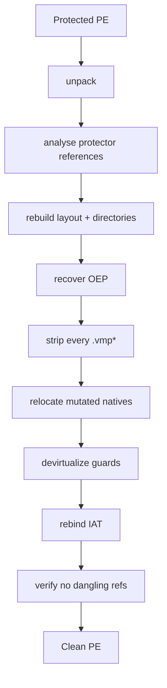

<h1 align="center">vmpx-expanded</h1>

<p align="center">
  <b>Static devirtualization and unpacking for VMProtect-protected x64 Windows binaries.</b><br>
  Strip the protector, recover the entry point and imports, devirtualize the
  guards — in one command.
</p>

<p align="center">
  <code>Rust</code> · <code>static-first</code> · the sample is never executed natively
</p>

---

A fork of [vmpx](https://github.com/skyboundfs/vmpx) that carries the pipeline all
the way to a clean, behaviour-preserving PE. The original stops short of emitting a
binary; this fork adds the final stages — entry-point recovery, import
reconstruction, native relocation, guard devirtualization — behind one command.

## Quick start

```sh
vmpx auto protected.dll clean.exe --dir out --log
```

One command runs the whole pipeline and reports each stage:

```
[vmpx] » ▶ start   Devirtualizing protected.dll
[vmpx] » i info    27 sections, image base 0x36b9a0000, 1259 import symbol(s)
[vmpx] » i info    protection: VmprotectLikely
[vmpx] » ▶ start   Analysing the application's protector references
[vmpx] » i info    reached 21 protector target(s): 14 guard(s), 7 mutated native(s)
[vmpx] » ▶ start   Rebuilding directories and stripping the protector   prev 69 ms
[vmpx] » ▶ start   Relocating mutated native functions                  prev 424 ms
[vmpx] » ▶ start   Devirtualizing guard functions                       prev 1.4 s
[vmpx] » ▶ start   Rebuilding the application import table              prev 69.1 s
[vmpx] » ▶ start   Verifying and writing                                prev 168 ms
[vmpx] » · file    out/clean.exe                                        204376064 bytes
[vmpx] » ✓ success clean PE written, 2 residual reference(s)            in 72.4 s
```

It analyses the binary and **chooses its own settings and targets** — the guard
and mutated-native addresses are discovered, not supplied. `--log` prints the
full per-step trace; a complete transcript is always written to `out/clean.log`.
With a packed input it unpacks first; `--snapshot <VMPXSNP1>` recovers the
application's imports (otherwise it asks before writing an image that will not
run). It never executes the protected sample — a contained software emulator
supplies a separate observed-only result, and that is the only thing that runs code.

## What it does

One command runs the whole chain, from a protected PE to a clean one:



## Where it stands

What the pipeline can do today, end to end:

| capability | status |
|---|---|
| Unpack a packed `.dll`/`.exe` to an analysis image | ✅ |
| Recover the original entry point (OEP) with no symbols, PDB, or DWARF | ✅ |
| Rebuild the section layout and data directories | ✅ |
| Strip every `.vmp*` section — VM, mutated stubs, packed original | ✅ |
| Relocate mutated native functions out of the protector, verbatim | ✅ |
| Recover and rebind the import table (IAT) from the encrypted `.idata` | ✅ |
| Annotate recovered code (timing, integrity, memory, import semantics) | ✅ |
| Prove no dangling reference into stripped space before writing | ✅ |
| Report each entry with the assumptions it rests on — or none (*proven*) | ✅ |
| Prove the rebuilt code equivalent to the original at the PE level | ☐ planned |

Each recovered VM entry is reported with the assumptions it rests on, never as a
single headline number — an entry counts as *proven* only when it closes with an
**empty** assumption set (nothing taken on trust).

## Soundness discipline

The parts worth knowing before trusting any output:

- **Fail closed.** Every recovery step refuses rather than guessing. A stall is
  recorded with its cause and the entry stays incomplete.
- **Labeled, not silent.** Anything unproven becomes a named assumption attached
  to that entry's result.
- **Three self-checks** per emitted function: an IR round-trip (the structured
  program against its own IR on random vectors), a C-text re-evaluation under real
  C typing and UB rules, and a linkage check against the independently unrolled
  recovered paths.
- **Honest widening.** Where abstract interpretation must generalize, it widens to
  an explicit unknown rather than narrowing to a convenient value, and the
  resulting imprecision shows up as a refusal downstream instead of as output.

## Build

```bash
cargo build --release
cargo run -p vmpx-cli -- --help
```

Useful entry points:

```bash
# tiered report over every discovered VM entry
vmpx report <image> --all --threads 16 --serve-ro

# raise recovered functions to C-like pseudocode
VMPX_DECOMPILE_SERVE_RO=1 vmpx decompile <image> --rva 0x...

# discover VM entry stubs and bootstrap profiles
vmpx vm-list <image>
```

`report` and `decompile` write nothing and execute nothing; they analyse.

There is also a desktop front end, `vmpx-ui`, which drives the CLI and renders
its JSON reports — pick a binary, tick the flags, set the environment, run:

```bash
cargo run --release -p vmpx-ui
```

### Settings that silently change the result

Some knobs widen what completes rather than erroring when left out — omit one and
the number just gets worse, never an error:

| for | pass | otherwise |
|---|---|---|
| `report` | `--serve-ro` | read-only image bytes go unresolved, so fewer than half the entries reach a complete control-flow graph |
| `decompile` | `VMPX_DECOMPILE_SERVE_RO=1` (no `--serve-ro` flag here) | CFG reads incomplete; one line instead of code |
| `--dynamic` | `--volatility-snapshot <snap>` | silent zero — bare detonation never finishes init |
| building that snapshot | `xpl_init_steps` example + `XPL_SNAPSHOT_OUT`, and raise `XPL_STACK_KB` | 8 MiB default overflows the guest stack → truncated snapshot |
| the init folds | leave `XPL_NOACCEL` / `XPL_NOLZMA` **unset** | the LZMA init never finishes |
| `VMPX_INSTRUCTION_LIMIT` | a multiplier, not an absolute | base is 512 on `report`, 100000 on `decompile` |

### Emulator throughput, and why a step is not the unit

The init is one routine. Profiling the first TLS callback puts **98.3% of its
steps inside a single 0x4000-byte window**, spread over 963 distinct addresses —
VMProtect's LZMA decompressor, flattened and padded with `jmp +0` and flag-only
junk. Three loop folds (`accelerate_checksums`, plus `accelerate_literals` for
the literal decoder) run the recognized loops natively.

Two things about measuring this are easy to get wrong, and both were got wrong
before they were measured:

- **Steps are not comparable across configurations.** A fold retires one step
  for an arbitrary number of guest instructions, so the steps/s figure *falls*
  when a fold starts working. On a 400M-step init the folded run does ~1,021M
  guest instructions in 3.5s where the unfolded run does 400M in 2.0s — 292M
  against 197M guest instructions per second. Compare decompressed output per
  wall-clock second, which is what `bytes=` in the fold line reports.
- **Recognition is probed at every block start, so a MISS has to be cheap.**
  Each recognizer originally walked the loop before testing anything, which cost
  more than the folding bought: the literal fold measured +22% progress per step
  and 35% *slower* in wall-clock. Rejecting on the first instruction's opcode,
  capping the pre-match padding chase, and a 32KiB negative filter in front of
  the shape caches took the same configuration from 145k to 544k output bytes/s
  with byte-identical output.

## Crates

`vmpx-pe`, `vmpx-disasm`, `vmpx-detect`, `vmpx-unpack` cover the file and
instruction layers. `vmpx-vm` holds the VM model, handler/codec recovery,
symbolic execution and CFG recovery; `vmpx-vmlift` lifts a recovered CFG to IR;
`vmpx-decompile` raises IR to C; `vmpx-verify` and `vmpx-solvers` provide the
equivalence machinery; `vmpx-mutation`, `vmpx-demutate` and `vmpx-tournament`
address native mutation; `vmpx-rebuild`, `vmpx-recompile` and `vmpx-emulate`
cover image emission and contained emulation. `vmpx-cli` is the front end.

## Design documents

Stage designs live in [`docs/superpowers/specs/`](docs/superpowers/specs/) —
native reintegration, generalized OEP recovery, the mutation engine, and the
dynamic engine.

## Legal and ethical use

This software is intended exclusively for:

- Defensive malware analysis in isolated laboratory VMs
- Academic and classroom instruction in reverse engineering
- Incident-response work where the analyst has lawful possession of the sample
- Security research published openly

You must not use this tool:

- Against software you do not own or do not have written permission to analyse
- To defeat licensing or DRM on commercial software
- To distribute unpacked malware binaries to parties who would not otherwise
  have lawful access

Nothing here is a grant of permission to analyse a particular binary. Lawful
possession and, where it applies, written authorisation are the user's
responsibility.

MIT licensed, as the upstream project.
